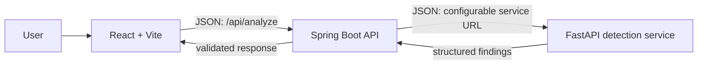

# Architecture

## Request flow

The frontend calls only the Java API. The Java service validates the browser request, calls Python through a configurable base URL, and returns the analysis response. Python owns the explainable detection rules, chronology analysis, heuristic score, evidence, recommendations, and verification checklist.

## Trust and privacy boundaries

- Message and URL fields are untrusted input. Validate lengths and modes at each API boundary.
- Do not automatically open submitted URLs, transmit messages to third parties, or persist submissions by default.
- Avoid logging submitted message content.
- Risk scores are heuristic estimates, not fraud probabilities or proof. Multiple indicators and their context must be explained.
- Checklist completion records user progress only; it never establishes that an offer is genuine.
- Keep service addresses configurable and credentials (if later needed) outside source control.

## Planned component responsibilities

- `frontend/`: message/conversation/URL input, results, timeline, and interactive verification checklist.
- `backend/`: public REST endpoints, request/response DTOs, validation, and a configurable client for Python.
- `detection-service/`: FastAPI routes and modular rule/scoring logic, initially without an ML dependency.
- `tests/`: detector unit tests and later API/integration coverage.
- MySQL, evaluated ML models, and browser extensions are out of scope until the local core works.

