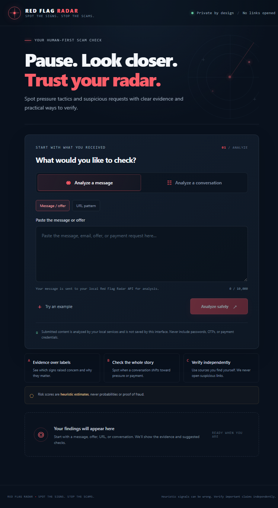
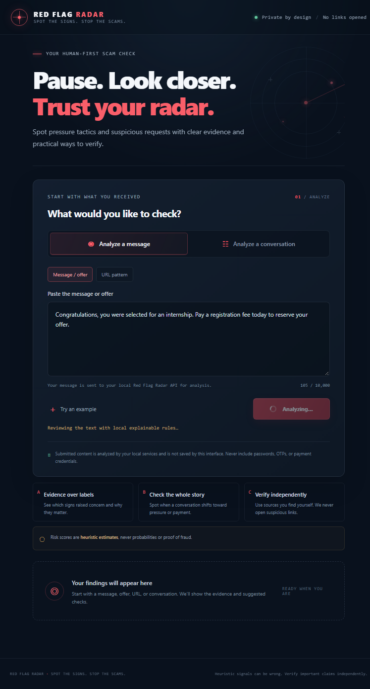
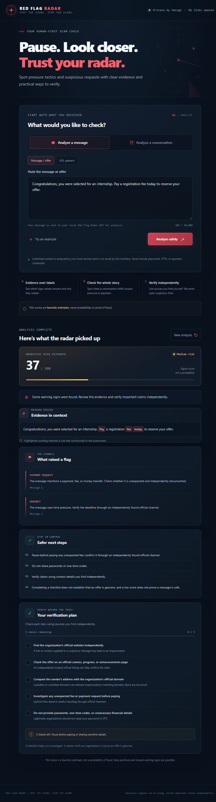
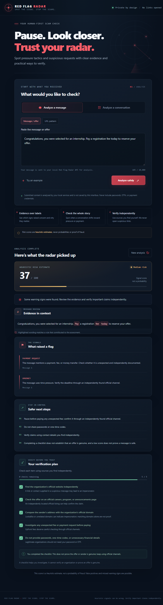
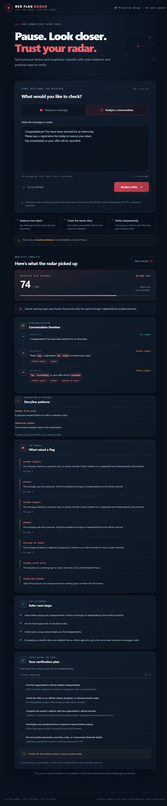
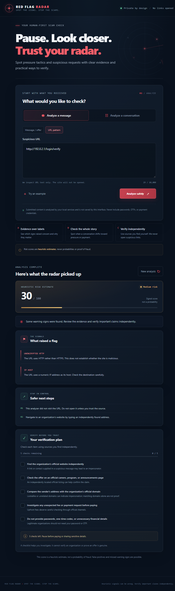
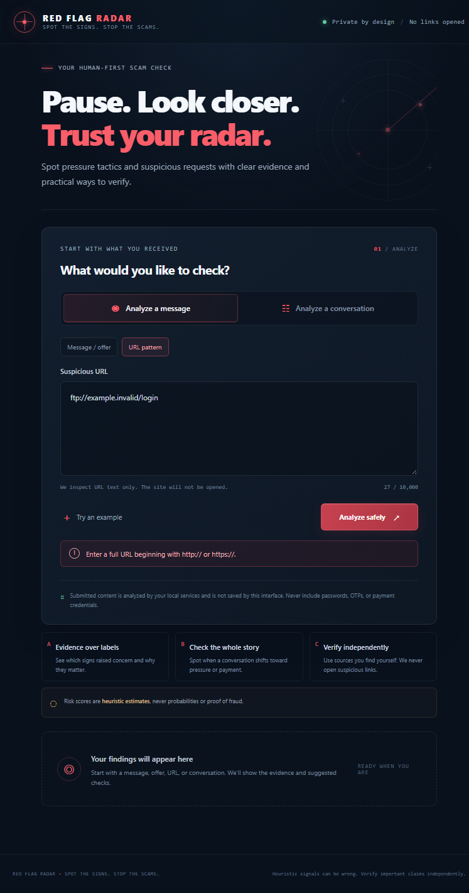

# Browser screenshot gallery

Captured from the local React app in a headless Chrome browser at a 1440 × 1200 viewport. Results and interactions use the live Java-to-Python services and fabricated sample content.

| State | Screenshot |
| --- | --- |
| Empty, ready-to-analyze screen |  |
| Pending request with disabled button and progress note |  |
| Single message findings and evidence |  |
| All five checks completed with the legitimacy reminder |  |
| Conversation timeline and storyline patterns |  |
| URL text findings without visiting the destination |  |
| Invalid URL validation feedback |  |

## Repeat the browser check

Keep Python, Java, and Vite running, then start headless Chrome with a debugging endpoint in PowerShell (adjust the executable path if needed):

```powershell
Start-Process -FilePath 'C:\Program Files\Google\Chrome\Application\chrome.exe' -ArgumentList @('--headless=new', '--disable-gpu', '--remote-debugging-port=9222', '--remote-allow-origins=*', "--user-data-dir=$env:TEMP\redflagradar-chrome", 'about:blank') -WindowStyle Hidden
node .\tools\browser_demo_check.mjs
```

The script refreshes these captures and exits nonzero if a checked UI state fails.
